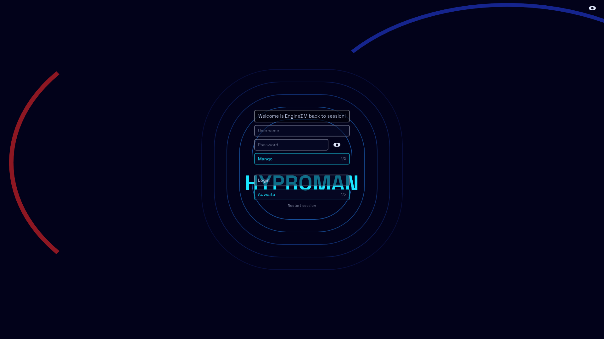

<p align="center">
  
</p>

<h1 align="center">EngineDM (enginedm-rs)</h1>

<p align="center">
  A lightweight display manager written in Rust, with login screens built from plain HTML and CSS.Forked HyprDM project is EngineDM.
</p>

<p align="center">
  
</p>

EngineDM is a login manager for Linux (OpenRC, systemd and greetd setups). The greeter, authentication, two-factor login and session handling are all Rust. The login screen itself is a normal web page (`main.html` + `style.css`) rendered by [Blitz](https://github.com/DioxusLabs/blitz), so you can restyle it without touching any code and without a browser, Qt or QML.

It is a fork of the Hyprdm EngineDM project with the C/C++ and Quickshell/QML parts rewritten.

## Features

- **HTML/CSS interfaces.** No JavaScript, no toolkit. The host drives the page by element id, so a theme is just two files.
- **PAM login** for the user you actually type in, with account checks (expired or locked accounts are refused) and the password wiped from memory right after authentication.
- **Two-factor login** with TOTP or HOTP, clock-drift tolerance, and a persisted HOTP counter. A misconfigured 2FA setup refuses logins instead of letting them through.
- **Two ways to start sessions:** hand over to [greetd](https://sr.ht/~kennylevinsen/greetd/) (recommended) or run standalone with the built-in PAM session host.
- **Session picker and GTK theme picker** on the login screen, populated from your installed `.desktop` sessions and themes.
- **Wallpaper support** and a **picture inspector** to browse and set a background right from the login screen.
- **Restart session** without logging out again (standalone mode).
- **Runs on Weston kiosk-shell**, so the greeter is fullscreen with no panels and no way to reach a terminal.
- **Init system support:** OpenRC and systemd services, plus a greetd config, all installed by one script.
- **Safe fallback.** If a custom interface is missing or broken, the built-in Hyproman is loaded so you are never locked out.

## Project layout

| Path | What it is |
|---|---|
| `crates/edm-core` | Core library: config, accounts, PAM, OTP, greetd client, session supervision |
| `crates/edm-greeter` | The greeter (`enginedmgreeterd`), Rust logic + Blitz UI |
| `crates/edm-configmanager` | `configmanager`, a small tool to set up the config and services |
| `interfaces/Hyproman` | The bundled interface (`main.html`, `style.css`) |
| `interfaces-examples/` | Screenshots of interfaces |
| `data/` | Config, PAM, Weston, greetd, OpenRC and systemd files |
| `install.sh` | Interactive installer / uninstaller |

## Requirements

- Rust (stable) and Cargo
- `weston` with kiosk-shell (Weston 10 or newer)
- `openvt` (package `kbd`) for the OpenRC/systemd standalone setup
- `elogind` or `seatd` (OpenRC), or systemd-logind
- PAM, and a GPU/driver that Weston can use
- Optional: `greetd` (recommended), `dbus-run-session` for sessions on non-systemd systems

## Build

```sh
cargo build --release
```

Optional checks:

```sh
cargo test -p edm-core -p edm-greeter --no-default-features   # logic only, no Blitz
cargo check -p edm-greeter                                    # Blitz glue
enginedmgreeterd --check                                      # config, interface and sessions, no window
```

The `wallpaper` feature (on by default) is what lets Blitz draw background images. Build with `--no-default-features` for a logic-only build without GPU dependencies.

## Install

```sh
./install.sh --install              # asks, item by item, what to install
./install.sh --install --yes-all    # install everything
./install.sh --remove               # asks, item by item, what to remove
```

The installer builds the project and installs the programs (`/usr/bin/enginedmgreeterd`, `/usr/bin/configmanager`), the Hyproman interface, the PAM service, the Weston config, and the service files for your init system. It never overwrites an existing `enginedm.conf`.

### With greetd (recommended)

greetd owns PAM, the logind session, the VT and the seat. EngineDM only checks the password and 2FA, asks greetd to start the session, and exits. This is the cleanest display handover and does not need root for the greeter.

The installer places a ready config at `/etc/greetd/enginedm-config.toml`; use it as your greetd config. It runs `/usr/libexec/enginedm-weston`, which starts Weston in kiosk mode, runs the greeter inside it and stops Weston when the greeter exits. The greeter runs as the `greeter` user, so it needs write access to `/var/lib/enginedm` and read access to the config (the installer sets this up when that user exists).

### Standalone on OpenRC

```sh
sudo rc-update add enginedm default
sudo rc-service enginedm start      # log: /var/log/enginedm.log
```

Set `pam_service=enginedm` in `/etc/enginedm/enginedm.conf` so a logind session is created. The service runs the greeter on VT 7 inside Weston under `supervise-daemon`; after login the greeter hands the VT to the user's session and comes back when the session ends. Session output goes to `/var/log/enginedm-session.log`.

### Standalone on systemd

```sh
sudo systemctl enable enginedm.service     # takes over display-manager.service
sudo systemctl set-default graphical.target
sudo systemctl start enginedm.service
```

Disable any other display manager first (`systemctl disable gdm`, etc.). The unit conflicts with `getty@tty7`, the greeter's VT. It uses the same run loop and `/etc/conf.d/enginedm` as the OpenRC service.

Standalone mode needs root to start sessions for other users. greetd mode does not.

## Configuration

Everything lives in `/etc/enginedm/enginedm.conf`: plain `key=value` lines, `#` for comments. A fully commented example is in [`data/enginedm/enginedm.conf`](data/enginedm/enginedm.conf).

| Key | Default | Description |
|---|---|---|
| `interface` | `Hyproman` | Interface folder to load (falls back to `default_session`) |
| `default_session` | `Hyprland` | Session pre-selected on the login screen |
| `theme` | `Adwaita-dark` | GTK theme applied at start |
| `wallpaper` | none | Background image (png/jpg/webp/gif, up to 32 MiB), absolute or relative to the interface folder |
| `pam_service` | `system-login` | PAM service for standalone mode (`enginedm` is recommended) |
| `dbus_wrap` | `true` | Start sessions under `dbus-run-session` on non-systemd systems |
| `two_factor_enabled` | `false` | Turn on two-factor login |
| `two_factor_method` | none | `totp` or `hotp` |
| `two_factor_secret` | none | Base32 secret (required when 2FA is on) |
| `autologin` | `false` in the example | Kept for compatibility. **If the key is missing it is treated as `true`**, so set it explicitly |
| `user_dirs { ... }` | `~/Pictures/*` | Folders the picture inspector indexes |
| `user_settings { ... }` | none | Personal settings such as the inspector's start list |

Because the config can contain your 2FA secret, keep it at `0640 root:greeter` (greetd) or `0600 root:root` (standalone). `configmanager` never prints the secret.

Standalone-mode runtime settings (VT, Weston backend and arguments, seat backend, splash handling) are in `/etc/conf.d/enginedm`.

### Two-factor login

Set `two_factor_enabled=true`, choose `totp` or `hotp`, and add a Base32 secret. Codes are checked with zero padding and a ±1 step window for clock drift. For HOTP the counter is stored in `/var/lib/enginedm/hotp_counter`; changing the secret resets it to 0 automatically. If 2FA is enabled but the method or secret is missing, every login is refused with a clear message.

### Wallpaper and the picture inspector

Set `wallpaper=` for a fixed background, or use the eye button (top right in Hyproman) to open the inspector. It indexes the folders from your `user_dirs` block:

```
user_dirs {
    Pictures=/home/me/Pictures/*     # this folder and everything below it
    Walls=/usr/share/backgrounds     # only pictures directly in this folder
}
```

Type in the search box to find pictures; click one to use it. The choice is saved into `wallpaper=` (this needs root; otherwise the picture is only kept for the current screen). A `user_settings { filter=... filter_known=N }` block controls which pictures are listed while the search box is empty. See the example config for the details.

### Restarting a session

In standalone mode the `#restart` button, or the command below, restarts the running session inside the same PAM session (no new login):

```sh
sudo enginedmgreeterd --restart-session
```

This is not available under greetd, because greetd owns the session.

## Writing your own interface

An interface is a folder with `main.html` and `style.css`. There is no JavaScript: EngineDM finds elements by `id` and fills them in. Put the folder in `/etc/enginedm/interfaces/`, `/usr/local/share/enginedm/interfaces/` or `/usr/share/enginedm/interfaces/` (or point `$EDM_INTERFACE_DIR` at it) and set `interface=<folder name>`. Look at `interfaces/Hyproman` as a reference.

| IDs | Purpose |
|---|---|
| `#username` `#password` `#login` | **Required.** Login form |
| `#twofactor` `#twofactor-row` | Two-factor code field (the row gets class `hidden` when 2FA is off) |
| `#error` | Messages (`msg error` or `msg info`, plus `visible`) |
| `#sessions` `#themes` | Filled with `<button class="opt">` entries; the chosen one gets class `selected` |
| `#restart` | Restart-session button |
| `#password-toggle` `#password-toggle-show` `#password-toggle-hide` | Show/hide password |
| `#inspector-toggle` `#inspector` `#wallpapers` `#wallpaper-search` `#inspector-info` `#bg` | Picture inspector and background |

Pressing Enter in a field, or clicking `#login`, logs in.

## Command line

```
enginedmgreeterd [--config FILE] [--interface DIR] [--check] [--run-handoff] [--restart-session]
configmanager [--reload]
```
`--check` loads the config, interface and sessions, prints what it found and exits without opening a window. It is the quickest way to test a new interface or config.

## Troubleshooting

Common problems and fixes (black screen, VM rendering) are in [TROUBLESHOOTING.md](TROUBLESHOOTING.md).


## Changelog

What changed and what was fixed is tracked in [CHANGELOG.md](CHANGELOG.md).

## License

BSD 3-Clause. See [LICENSE](LICENSE).

# Support 
If you want to contribute to development:

[Support and Donate](https://www.patreon.com/Azccriminal)

[Contributed](https://codeberg.org/Zamanhuseyinli/enginedm/pulls)
